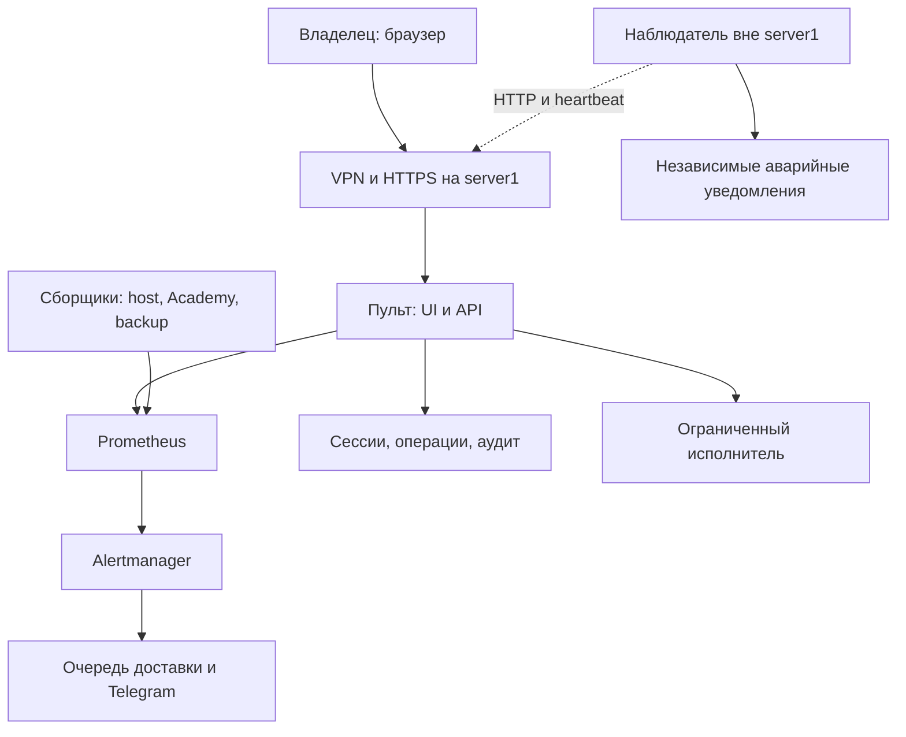

# Пульт USTAR: архитектура

**Текущая реализация первого LAN запуска17Oct:** [LAN выпуск и границы](LAN_ROLLOUT_20261017.md), [установка](INSTALL.md). Ниже сохраняется полный целевой дизайн16Oct; Prometheus/Alertmanager, web user admin, расширенные rules/restore/logs не объявляются поставленными. Первая LAN версия использует native bounded history/rules и отдельный fixed-operation broker.

Проектное решение16Oct2026, INF-06, PR103. Статус: архитектура и первый read-only auth/collector/API/UI срез подготовлены в исходниках; server1 не установлен, Telegram ещё не реализован. Точные границы — [README](README.md) и [INSTALL](INSTALL.md). Это спецификация для реализации, не свидетельство состояния server1. Связанные документы: [метрики и алерты](OBSERVABILITY.md), [UI/UX](DESIGN.md), [текущий контекст](../context/runtime/control_panel_telegram_20261016.md).

## 1. Что получает владелец

За несколько секунд понять: доступна ли Академия людям, хватает ли ресурсов, сохранены ли данные и работает ли сам мониторинг. Затем открыть причину, график и связанные логи. Отдельно — состояние контейнеров и стендов, последний проверенный бэкап, адреса/SFTP, история операций. Телефон и Telegram дают тот же статус, а не второй набор противоречивых правил.

Пульт размещается на server1, но работает вне контейнеров Moodle/PostgreSQL. Остановка Академии не должна останавливать пульт. Потерю самого server1 обнаруживает независимый внешний наблюдатель. Перенос Moodle5.2/PG17 не входит в поставку. Рабочая Академия остаётся native plugin/theme; новый operations UI не использует legacy `frontend/`.

## 2. Компоненты и границы

Стрелка сборщиков к Prometheus обозначает поток данных: технически Prometheus опрашивает их endpoints. Внешний HTTP-пробник проверяет реальный согласованный вход Академии; heartbeat дополнительно подтверждает работу collector. Сбой только VPN и сбой публичной Академии — разные инциденты.

| Компонент | Выбор и назначение | Ограничение |
|---|---|---|
| UI | TypeScript + React + Vite, отдельный `server-console/` | Статические assets; все права проверяет API |
| API | Python3.12 + FastAPI, systemd, отдельный непривилегированный пользователь | Нет Docker socket, root, произвольного shell/SQL/PromQL |
| Состояние | SQLite WAL: пользователи, сессии, jobs, аудит, outbox | Не БД Академии; метрики хранятся отдельно |
| История метрик | Prometheus | Loopback; фиксированные запросы API, ограниченные диапазоны/шаг/таймаут |
| Сборщики | node_exporter, blackbox_exporter, USTAR adapter | Endpoints loopback/Unix socket, фиксированный набор объектов |
| Алерты | Правила Prometheus + Alertmanager | Одно определение инцидента для UI и Telegram |
| Telegram | Отдельный worker с outbound long polling и outbox | Не требует публичного webhook; секреты вне git |
| Операции | systemd worker + узкий привилегированный helper | Только перечисленные действия, отдельные права, общий maintenance lock |
| Внешний observer | Другая машина/провайдер, собственная доставка | Не зависит от диска, сети, API, БД и bot worker server1 |

Точные версии зависимостей фиксируются lockfiles при реализации. Установка Prometheus/Grafana-стека ради стандартного dashboard не требуется: Grafana и Loki в первый выпуск не включены. Логи читаются ограниченно из существующих источников, не копируются целиком в ещё одно хранилище.

## 3. Доступ и безопасность

Базовый вариант: закрытый VPN-доступ к серверу + доверенный HTTPS + отдельный логин/пароль пульта. Покупка поддомена не требуется; адрес и сертификат VPN-сети выбираются при настройке gateway. Возможность входить с телефона вне офиса входит в приёмку. Публичный admin HTTP/порт не открываем. Публичный HTTPS-доступ без VPN — отдельное последующее решение.

На host уже существуют Apache/Caddy и другие vhosts. До выбора listener нужно снять текущую карту портов/прокси; нельзя предполагать, что Caddy уже обслуживает TLS Академии. Пульт слушает loopback за выбранным gateway. Доступ к Академии через существующий127.0.0.1:8082 не меняется ради пульта.

- Отдельные роли `viewer`, `operator`, `owner`: просмотр; backup/lab jobs; пользователи/настройки/подтверждение production-операций. Сервер проверяет роль и объект на каждом запросе.
- Пароли Argon2id; сессии серверные, случайные opaque IDs в Secure/HttpOnly/SameSite cookies; CSRF на writes. Нет регистрации для всех, стандартного пароля и секретов в localStorage.
- Ограничение попыток входа и экспоненциальная задержка, журнал событий; idle session30мин/absolute12ч как начальная политика. Restore и изменение доступа требуют свежей повторной аутентификации.
- Предусмотреть TOTP для owner, отзыв всех сессий, аварийный локальный reset через SSH. Пульт не заменяет SSH/rescue-доступ.
- Collector читает только фиксированные поля. Docker-доступ технически высокопривилегирован: небольшой локальный helper изолируется и проверяет peer credentials; полный `docker inspect`, Env, secrets, arbitrary arguments не выдаются в API.
- PostgreSQL: отдельная monitor-роль и разрешённые stats/views, bounded SQL, statement timeout2s, lock timeout0.5s. Не использовать существующий cluster superuser Академии для UI.
- Секреты, backup keys, конфиги, query text, ФИО и токены не попадают в метрики, логи UI и Telegram. URL query strings очищаются. До внедрения redaction проверяется на синтетических секретах.

## 4. Контракт данных и источники

Каждый ответ содержит `observed_at`, `received_at`, `source`, `status`, `reason_code` и возраст данных. Внутри UTC, в UI по умолчанию Europe/Moscow с переключателем. Ошибка чтения не становится нулём. Устаревшее значение остаётся с отметкой возраста и не подтверждает текущую исправность.

| Данные | Проверенный источник/граница адаптера |
|---|---|
| CPU/RAM/IO/FS | `/proc`, `/sys`, node_exporter; память `MemAvailable`, cache отдельно |
| Контейнеры | Разрешённые имена/ID, running/exit/OOM/restart policy, cgroup CPU/RAM/IO/network; reconciliation ID отдельно от простоя |
| Systemd | Выбранные units и Result/SubState, не полный дамп host |
| HTTP | Локальный и внешний probe, allowlisted redirects, TLS/hostname проверяется; access-log агрегаты без параметров URL |
| PG | Соединения, блокировки, длительность транзакций, статистика БД; без текста запросов и персональных строк |
| Cron | JSON `USTAR_CRON_SETUP_20261005.py --status`, после проверки pinned helper и его write impact; не выдумывать путь внутреннего state |
| Backup | `/var/lib/ustar-backup/last-hdd-success.json`, `last-hdd-attempt.json`, `last-hdd-scheduled-run.json`, recovery marker `moodle-was-running.json`; timer/service properties |
| Архивы | `/srv/ustar-storage/backups/managed`, immutable archive ID + безопасный basename + размер/SHA/snapshot receipt |
| Стенд восстановления | `/var/lib/ustar-restore-test/20261014/state.json`, phase/ready/expires_at/hold_seconds/unlimited; фактический контейнер и доступность отдельно |
| SSD-копия | Датированный receipt host cold recovery; не выдавать за свежий ежедневный Academy backup или boot-tested image |
| SFTP/transfer | Разрешённые export directories; transfer kit может содержать ключ и не доступен через Telegram |

Все пути проверяются на границы, symlinks и доступы. Разбор существующих JSON ограничен размером, схемой и временем. Root helper не запускается заново на каждый browser GET: collector обновляет кэш независимо от открытых страниц. Источник с неизвестной схемой → `unsupported_source`, не зелёный статус.

Обычный HTTP GET Moodle может создать session/access-log запись. До выбора probe endpoint проверить побочные эффекты; не утверждать абсолютную read-only семантику bootstrap. Первый выпуск не выполняет тесты/SCORM/запись прогресса от имени реального сотрудника. HTTP200 подтверждает только выбранный сценарий, не работоспособность всего обучения.

## 5. Наблюдаемость и бюджет

Host/container15s; HTTP/PG30s; cron/backup/lab30–60s; SMART15min без запуска новых долгих тестов. Метрики собираются при закрытом UI. UI получает SSE/cache updates каждые5–15s с HTTP fallback и видимой потерей соединения. API ограничивает диапазоны1h/24h/7d/15d и число точек; при нескольких вкладках сбор не учащается.

Начальные ресурсные бюджеты — критерии измерения, а не заявленные расходы: steady RAM всей подсистемы≤512MiB целевой, ≤1GiB верхний приёмочный предел; средний CPU<2% всей машины за час штатного сбора; активных series≤2000. Если бюджет не достигнут, уменьшить collectors/retention до production-подключения, не скрывать перерасход.

Prometheus retention15дней или раньше по размеру blocks2GiB. Это **не** общий лимит: WAL/head/compaction требуют дополнительного места. Выделить на SSD бюджет6GiB для метрик/состояния/служебных логов, измерить peak и оставить минимум4GiB root reserve. Пульт показывает реальное покрытие истории. Не использовать backup HDD как единственное место хранения мониторинга.

Аудит/инциденты90дней с бюджетом250MiB и ограничением полей; при достижении лимита экспорт/retention по утверждённой политике. При невозможности durable audit новые изменяющие jobs блокируются, наблюдение продолжается. Записи активных jobs не удаляются retention. Шифрованные бэкапы Академии автоматически не удаляются. Backup собственного state пульта нужен отдельно, с секретами через защищённый канал; восстановление пульта не должно требовать работающего пульта.

## 6. Telegram и выдача бэкапа

Входящие команды разрешены по numeric user ID **и** chat ID с ролью; group chats по умолчанию запрещены. Начальные команды `/status`, `/metrics`, `/incidents`, `/labs`, `/backup latest`. Update ID хранится durable; повтор команды не создаёт новую операцию. Уведомления: что сломалось, влияние, время, ключевая метрика, incident ID и ссылка на детали. Recovery отправляется один раз после стабилизации.

Alertmanager webhook доступен только локально. Worker принимает сообщение после durable записи outbox; dedup по alert fingerprint + переходу состояния. Retry с backoff и пределом очереди; возраст oldest undelivered виден в health. При переполнении агрегировать повторы, сохранять факт потери доставки, не отмечать инцидент «отправленным». Независимый observer имеет отдельную конфигурацию доставки и запасной канал; outage Telegram нельзя надёжно сообщить через тот же Telegram.

`/backup latest` выбирает последний **completed/hash-verified** зашифрованный архив, показывает snapshot time/size/SHA. Не запускает новый backup и не выбирает partial/последнюю попытку. Для текущих больших архивов выдаётся авторизованная ссылка пульта: token10мин, ограниченный archive ID, обязательная operator-сессия и audit. Получателю нужен настроенный VPN; токен сам по себе не открывает файл. Продолжение скачивания допускается той же сессии в ограниченном download window, повтор после истечения требует новой ссылки.

Полное повторное чтение гигабайт не выполняется на каждом scrape: показывать дату последней hash verification; изменение file metadata инвалидирует проверку. Background/manual verify — отдельный bounded IO job. Recovery key, SSD root.tar и transfer kit с ключом не выдаются ботом. Это не offsite backup: ссылка ведёт на тот же server1.

## 7. Управляемые действия

Операция: `plan → confirmation → preflight → queued → running → verification → succeeded/failed/recovery_required`. В плане: среда, цель, archive snapshot, затрагиваемые службы, простой, проверка восстановления, lock и команда-адаптер фиксированной версии. Plan имеет срок и revision; изменение состояния до исполнения требует перепроверки. Idempotency key, очередь и audit сохраняются при закрытии браузера.

- Только allowlist: manual Academy backup; prepare export; lab start/stop/TTL; проверка архива; отдельные maintenance/restart; подготовка restore. Не универсальная root-консоль.
- Существующий maintenance lock общий с cron/backup scripts; занятость показывает владельцу причину. Не удалять чужой lock, не запускать конкурирующий backup/restore.
- После reboot исполнитель сверяет сохранённый job с receipts/process state. Не повторяет destructive step автоматически. Cancel допустим только на явно безопасном шаге; копирование/restore не убивается по закрытию вкладки.
- Стенд: default1ч, оператор задаёт TTL; крайний срок и cleanup переживают reboot. Expected-off не инцидент. Постоянная копия/production не получает TTL. URL, exposure и дата автоостановки видны до запуска.
- Production restore и full host restore различны. Full host/SSD restore не включён в первую web-версию; инструкция rescue отдельно. Production restore требует owner reauth/точного target/плана и подтверждения в UI. Telegram может открыть план, но не восстановить production одной командой.
- SFTP в первом выпуске — адрес/порт/user/path/fingerprint и доступ к разрешённым экспортам через WinSCP. Не browser-root file manager. Пароль SFTP не хранится в пульте; загрузка кода/config через UI не добавляется.

## 8. Этапы и проверяемая готовность

| Этап | Результат | Приёмка |
|---|---|---|
| A. Защищённый read-only | Auth, gateway, collector, health, реальные графики | Viewer не меняет host; неизвестные/stale значения видны; root/Docker/секреты недоступны вебу; вход с телефона извне |
| B. Инциденты | Правила, UI, Telegram, внешний observer | Испытать failure/NoData/recovery, host-loss, недоставку, повтор/ack/silence; уведомления без PII |
| C. Backup и стенды | Каталог, verified download, адреса/TTL/SFTP | Hash скачанного совпадает, archive age правдив, key недоступен; expired lab убран, production не остановлен |
| D. Операции | Allowlisted jobs, locks, audit, recovery | Double-click/concurrent backup, browser close, restart worker, stale plan; нет повторного destructive шага |
| E. Native acceptance | Реальные метрики/ресурсный бюджет/UX | 7дней baseline; desktop/mobile/keyboard; все ошибки имеют источник/действие; нет побочных изменений Academy/mail/DNS |

До реализации нужны только фактические настройки: gateway/listeners, VPN/cert, operator IDs/token, место внешнего observer, monitor DB grants. Сейчас их нет: не подставлять вымышленные credentials или production endpoint. Native outage-тест согласуется отдельным окном; лабораторные сбои не доказывают host-loss. Возможность clean-host восстановления остаётся OPS-02 и ожидает сисадмина.

## Первичные технические основания

Проверены16Oct2026: [Prometheus storage](https://prometheus.io/docs/prometheus/latest/storage/), [node_exporter](https://prometheus.io/docs/guides/node-exporter/), [blackbox_exporter](https://github.com/prometheus/blackbox_exporter), [Alertmanager](https://prometheus.io/docs/alerting/latest/alertmanager/), [Docker daemon access](https://docs.docker.com/engine/security/protect-access/), [PostgreSQL16 statistics](https://www.postgresql.org/docs/16/monitoring-stats.html), [Telegram Bot API](https://core.telegram.org/bots/api). Выбор компонентов и бюджетов — проектное решение USTAR; эти источники не подтверждают deployment на server1.
